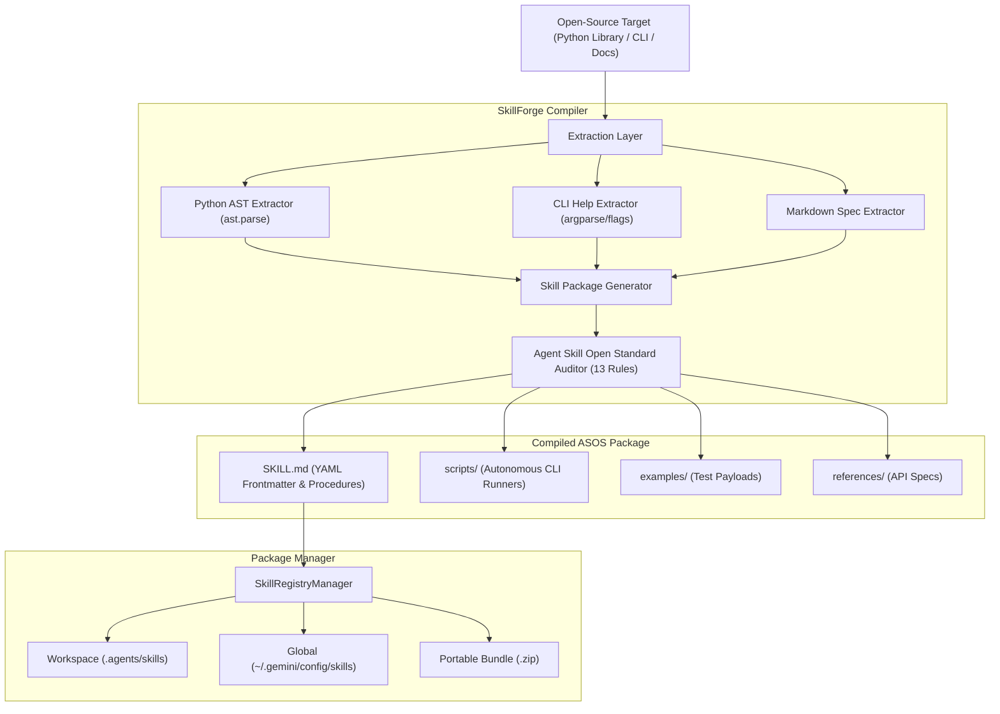

# SkillForge

> Official MLH Challenge: Best Open-Source AI Project
> Hacktoberfest Hack Day, Hyderabad | MLH x DEV x NIAT - KKH
>
> The Agent Skill Open Standard (ASOS) Compiler and Package Manager.
> Compiles any Python library, CLI executable, or documentation into a validated, installable agent skill.

[](LICENSE)
[](https://github.com/agent-skills/open-standard)
[](https://python.org)

---

## Technical Overview

Modern coding agents (Antigravity, Claude Code, Cursor, OpenHands) rely on the **Agent Skill Open Standard** to execute specialized workflows. However, open-source library authors and maintainers face high friction in manually authoring `SKILL.md` specifications, typed YAML schemas, standalone CLI wrappers in `scripts/`, test fixtures, and progressive disclosure references.

**SkillForge** is an open-source compiler and package manager that synthesizes three core workflows:
1. **Extraction Engine** (inspired by `anything-to-skill`): Inspects Python ASTs, CLI `--help` manuals, and markdown documentation to extract typed parameters, function signatures, and docstrings.
2. **Quality & Validation Linter** (inspired by `upskill`): Audits generated packages against the 13 strict rules of the Agent Skill Open Standard.
3. **Skill Package Manager** (inspired by `skills-cli`): Installs, lists, exports, and uninstalls skills across workspace (`.agents/skills`), global (`~/.gemini/config/skills`), or custom agent directories.

---

## Architecture



---

## Installation

Install SkillForge locally via pip:

```bash
git clone https://github.com/your-username/skillforge.git
cd skillforge
pip install -e .
```

---

## CLI Reference

### 1. Compile an Agent Skill

Compile any Python library or module into a complete, compliant skill package:

```bash
skillforge compile examples/sample_library.py --name audio-dsp-toolkit
```

Compile a command line executable:

```bash
skillforge compile /usr/bin/git --name git-toolkit --type cli
```

### 2. Validate Against Agent Skill Open Standard

Run the 13-point automated compliance auditor on any skill:

```bash
skillforge validate output_skills/audio-dsp-toolkit
```

Checks verified:
- Directory structure and `SKILL.md` existence
- Frontmatter enclosure (`---`) and required fields (`name`, `description`, `version`, `license`, `inputs`, `outputs`)
- Kebab-case naming format
- Description quality (minimum 20 characters, 3rd-person context)
- Typed dictionary schemas for inputs and outputs
- Executable helper tools in `scripts/`
- Progressive disclosure isolation in `references/`
- Internal relative link resolution

### 3. Install Skills into Agent Runtimes

Install into current workspace (`.agents/skills/`):

```bash
skillforge install output_skills/audio-dsp-toolkit --workspace
```

Install globally (`~/.gemini/config/skills/`):

```bash
skillforge install output_skills/audio-dsp-toolkit --global
```

Install into a custom AI agent directory:

```bash
skillforge install output_skills/audio-dsp-toolkit --target /path/to/agent/skills
```

### 4. List and Inspect Installed Skills

```bash
skillforge list
```

### 5. Export Portable Distribution Archive

Package the skill into a `.zip` archive ready for distribution:

```bash
skillforge export output_skills/audio-dsp-toolkit --output audio-dsp-toolkit.zip
```

### 6. Launch Developer Studio

Start the local technical workbench at `http://127.0.0.1:8899`:

```bash
skillforge serve --port 8899
```

---

## Automated Test Suite

Run the full verification suite:

```bash
py -m unittest discover tests
```

```text
Ran 7 tests in 0.202s - OK
- test_extract_capabilities (Static Python AST extraction)
- test_parse_help_text (CLI help flag parsing)
- test_full_package_compilation (End-to-end ASOS generation)
- test_audit_missing_skill_md (Linter negative testing)
- test_audit_valid_skill (Linter 100% compliance verification)
- test_install_and_list_skills (Registry installation & discovery)
- test_export_archive (Zip distribution creation)
```

---

## 2-Minute Live Demo Walkthrough (For Hackathon Judges)

1. **The Context (0:00 - 0:30)**:
   "Judges, the official challenge asked for an open-source AI project advancing the Agent Skill Open Standard. Current coding agents need skills, but open-source authors have no standard way to turn their libraries into skills without manual boilerplate. We built SkillForge: the compiler and package manager that turns any library or CLI into an Agent Skill."

2. **Compilation (0:30 - 1:10)**:
   *(Run `skillforge compile examples/sample_library.py --name audio-dsp-toolkit`)*
   "Here, SkillForge inspects our Python library using AST analysis. It extracts all functions, parameter types, default values, and docstrings. In seconds, it generates `SKILL.md` with typed YAML schemas, standalone CLI runners in `scripts/`, test cases in `examples/`, and references."

3. **Standard Audit (1:10 - 1:40)**:
   *(Run `skillforge validate output_skills/audio-dsp-toolkit`)*
   "Next, we audit the compiled package with our standard linter. Notice that all 13 rules of the Agent Skill Open Standard pass with a 100/100 score, including kebab-case validation, schema typing, and relative link resolution."

4. **Installation & Packaging (1:40 - 2:00)**:
   *(Run `skillforge install output_skills/audio-dsp-toolkit --workspace && skillforge list`)*
   "Finally, our package manager installs the skill directly into `.agents/skills` where any compliant coding agent discovers it automatically. SkillForge empowers the entire open-source ecosystem to convert their tools into Agent Skills. It is MIT-licensed and ready for use."

---

## License

This project is licensed under the [MIT License](LICENSE).
